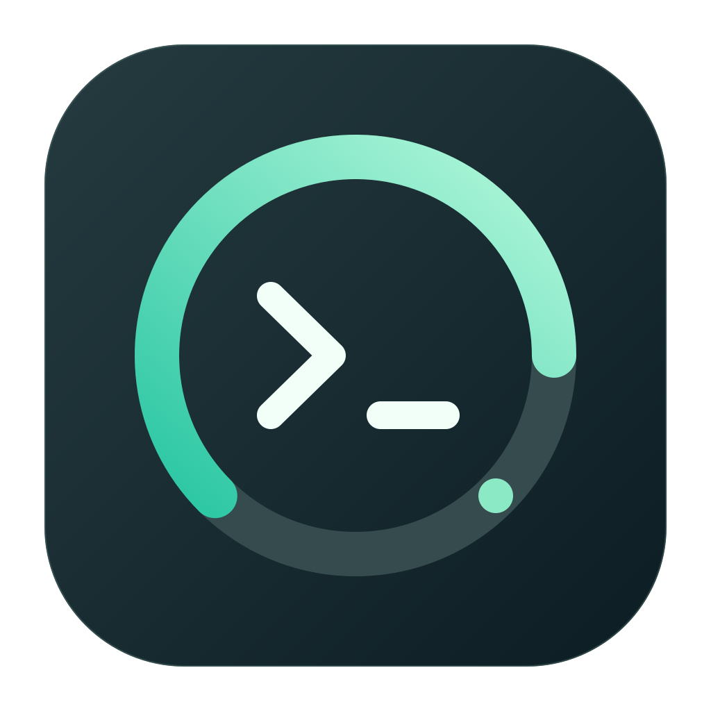
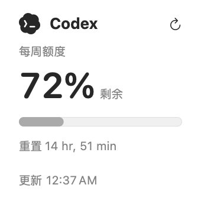
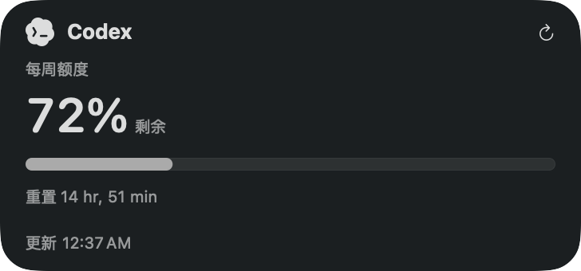
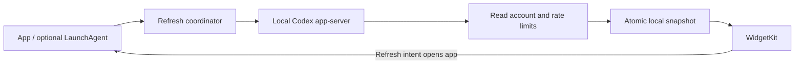

<div align="center">
  
  <h1>Codex Usage</h1>
  <p><strong>Your Codex quota. Right on your Mac desktop.</strong></p>
  <p>A native macOS companion for remaining usage, reset times, and refresh status.</p>
  <p><strong>English</strong> · <a href="README.zh-CN.md">简体中文</a></p>
  <p>
    
    
    
    <a href="https://github.com/Daltan/codex-macos-widget/stargazers"></a>
  </p>
  <p><a href="#quick-start">Quick start</a> · <a href="#how-it-works">How it works</a> · <a href="CONTRIBUTING.md">Contribute</a> · <a href="https://github.com/Daltan/codex-macos-widget/issues/new/choose">Report an issue</a></p>
</div>

Know where your quota stands before your next coding session. Keep a compact widget on your desktop, inspect all returned windows in the app, and refresh using your existing Codex login.

> Independent community project. Not affiliated with or endorsed by OpenAI. The app interface is currently Chinese; documentation is available in English and Chinese.

## Preview

<p align="center">
  
  
</p>

Native SwiftUI renders of the small and medium layouts, using a local successful snapshot. These are layout previews, not desktop screenshots; macOS wallpaper tint and system rendering may differ. No account details are shown.

## Why use it?

| Feature | What you get |
| --- | --- |
| Native desktop widgets | Small for a quick glance; medium for up to two quota windows. Light and dark appearance. |
| Actual quota data | Remaining percentage and reset time from Codex. No guessed message counts or invented usage windows. |
| Existing login | Authentication stays with your local Codex CLI. No additional account, API key, or hosted backend. |
| Honest freshness | Last successful data survives failures, with explicit stale and error states. |
| Refresh controls | Refresh from the app, menu bar, or widget. Optional hourly LaunchAgent for background queries. |
| Small codebase | SwiftUI + WidgetKit, no third-party runtime dependencies. A separate protocol adapter and testable core. |

The large widget has been retired: a single returned quota window did not justify its footprint. Remove an existing large widget and add a small or medium one. All returned quota buckets remain available in the main app.

## Quick start

**[Download the latest DMG or ZIP](https://github.com/Daltan/codex-macos-widget/releases/latest)** — no Xcode required. Open the DMG and drag **Codex Usage.app** to **Applications**, then launch the installed app. Requires macOS 14+ and Codex CLI signed in with a ChatGPT account.

The downloadable build is **ad-hoc signed and not notarized**. First launch may be blocked by macOS; see the [bilingual installation guide](Docs/INSTALL.txt) for Apple’s supported opening flow and known limitations. Other-Mac installation and Intel hardware have not been verified.

### Build from source

Requirements: **macOS 14+**, full **Xcode** to build from source, and **Codex CLI signed in with a ChatGPT account**. Apple Silicon is tested locally; the build also includes Intel code, but Intel hardware has not been tested.

```sh
git clone https://github.com/Daltan/codex-macos-widget.git
cd codex-macos-widget
Scripts/build.sh
Scripts/install-app.sh
```

`Scripts/build.sh` also produces a Universal DMG, ZIP, installation guide and SHA-256 checksums under `.build/releases/`. See [release packaging](Docs/RELEASING.md).

1. Open `~/Applications/Codex Usage.app` and let the initial query complete.
2. Right-click your desktop → **Edit Widgets** → search for **Codex Usage**.
3. Add a small or medium widget. Its refresh button opens the app to fetch fresh data.

Quit the existing app before installing an update. You can also open `CodexUsage.xcodeproj` and run the `CodexUsage` scheme. Builds use local ad-hoc signing and are not notarized; successful installation on this Mac does not establish distribution compatibility on other Macs. The build script sets `DEVELOPER_DIR` without changing system `xcode-select`.

If the CLI cannot be found, use the gear button in the app to select the Codex executable. Homebrew locations and the bundled CLI are searched automatically. If you set `CODEX_HOME`, keep it consistent between launch methods: Finder and LaunchAgents do not inherit custom shell environments.

## How it works



The adapter follows the documented [Codex app-server protocol](https://developers.openai.com/codex/app-server): start `codex app-server --stdio`, perform the `initialize` / `initialized` handshake, call `account/read` with `refreshToken: false`, then `account/rateLimits/read`, and close the child process. It does not start a conversation or request model work.

Remaining usage is `100 − usedPercent`, clamped to 0–100%. The progress bar represents **used** quota. Multiple `rateLimitsByLimitId` buckets are supported, with single-bucket compatibility. A five-hour window appears only when the service returns one. No absolute remaining message count or historical trend is fabricated.

The adapter was verified with Codex CLI **0.165.0**. This is a client protocol, not a guaranteed stable standalone quota REST API. API-key-only accounts are not represented as ChatGPT subscription quota.

## Privacy and storage

- Codex owns authentication and any necessary session renewal. The monitor does not read, copy, or store tokens, cookies, API keys, or Keychain credentials.
- The monitor does not call login, logout, subscription mutation, or configuration-writing RPCs. Account email is masked before persistence.
- The cache is `~/Library/Application Support/CodexUsage/usage.json`, written atomically with directory mode `0700` and file mode `0600`.
- The widget reads that cache. It has no network entitlement or access to the Codex authentication directory.
- The app must launch your existing CLI, so it is not sandboxed. For local ad-hoc builds, the widget uses a narrowly scoped read-only file sandbox exception. Formal distribution would require appropriate signing, App Groups, and separate validation.
- Raw protocol output and authentication data do not belong in logs, issues, screenshots, or commits.

## Refresh behavior

| Trigger | Behavior |
| --- | --- |
| App launch | Queries immediately, subject to duplicate-request suppression. |
| App running | Checks every minute whether an hourly query is due; checks again after wake. |
| WidgetKit | Requests hourly cache reloads; macOS may delay rendering. |
| Manual refresh | Opens the app, disables the button while busy, and requests timeline reload on completion. |
| Optional LaunchAgent | Runs the app with `--refresh-once` every 3,600 seconds while logged in. |

Sleep, shutdown, logout, offline periods, and system budgets can delay updates. Neither background queries nor WidgetKit guarantee an exact hourly on-screen refresh. Data becomes stale after one hour, after a returned reset time, or after a failed query. Old values are never silently reset to zero. Last success and last attempt are stored separately.

### Optional background refresh

Run only if you want to install a user LaunchAgent:

```sh
Scripts/launch-agent.sh install
Scripts/launch-agent.sh status
Scripts/launch-agent.sh uninstall
```

This creates `~/Library/LaunchAgents/com.daltan.codexusage.refresh.plist`, with `RunAtLoad` and `StartInterval=3600`. No root access or Codex configuration changes are required. Uninstall stops the job and moves its plist to Trash, preserving the app and cache. Keep the app at its installed path; reinstall the agent if you move it. To stop all queries, uninstall the agent and quit the app.

## Troubleshooting

| Symptom | What to check |
| --- | --- |
| Login expired | Restore login in Codex, then refresh. Never submit a token or API key to this project. |
| Timeout / unavailable | Check network access and whether Codex CLI works. The last successful snapshot is preserved. |
| Cache error | Check ownership of the cache directory. Do not use `chmod 777`. Reinstall the app and refresh. |
| Widget missing | Launch the installed app once, then reopen the widget gallery. Check `pluginkit -m -A -D -i com.daltan.codexusage.widget`. |
| Background refresh stopped | Run `Scripts/launch-agent.sh status`; inspect runs, last exit code, and run interval. Exit 0 can also mean a valid recent attempt was reused. |
| Need diagnostics | Run the command below. Logs contain storage error categories and cache paths, not raw authentication data. |

```sh
log show --last 10m --predicate 'subsystem == "com.daltan.codexusage"'
```

To uninstall: remove the optional LaunchAgent, quit the app, move the app to Trash, and remove its widgets. You may separately remove this tool's cache and `com.daltan.codexusage` preferences. Do not delete `.codex`.

## Develop and contribute

```sh
DEVELOPER_DIR=/Applications/Xcode.app/Contents/Developer swift test
python3 Scripts/scan-secrets.py
git diff --check
```

| Location | Responsibility |
| --- | --- |
| `Sources/App/` | SwiftUI app, CLI discovery, read-only protocol adapter, refresh coordination. |
| `Sources/Core/` | Models, secure cache, shared views, refresh intent, vector Codex mark. |
| `Sources/Widget/` | Widget timeline and compact layouts. |
| `Tests/` | Parsing, freshness, persistence, scheduling, and isolated protocol transport tests. |
| `Assets/` | Editable SVG application icon and third-party attribution. |
| `Scripts/` | Build, install, project generation, icon rendering, background job, and secret scanning. |

Changed target membership or build settings? Update `Scripts/generate-project.py` and commit the regenerated project. Test data stays in isolated tests; production placeholders remain empty. See [validation evidence and limitations](Docs/VALIDATION.md) and the [contributing guide](CONTRIBUTING.md).

Useful contributions include CLI compatibility fixes, accessibility improvements, English UI localization, and installation reports from other Mac models. Future candidates include distribution signing and real historical data; these are not implemented features.

If this saves you a window switch, **give it a Star** so other Codex developers can find it. Bug reports and small, well-tested pull requests help even more.

[Icon sources and regeneration](Assets/README.md) · [Security reporting](SECURITY.md) · [中文文档](README.zh-CN.md)
