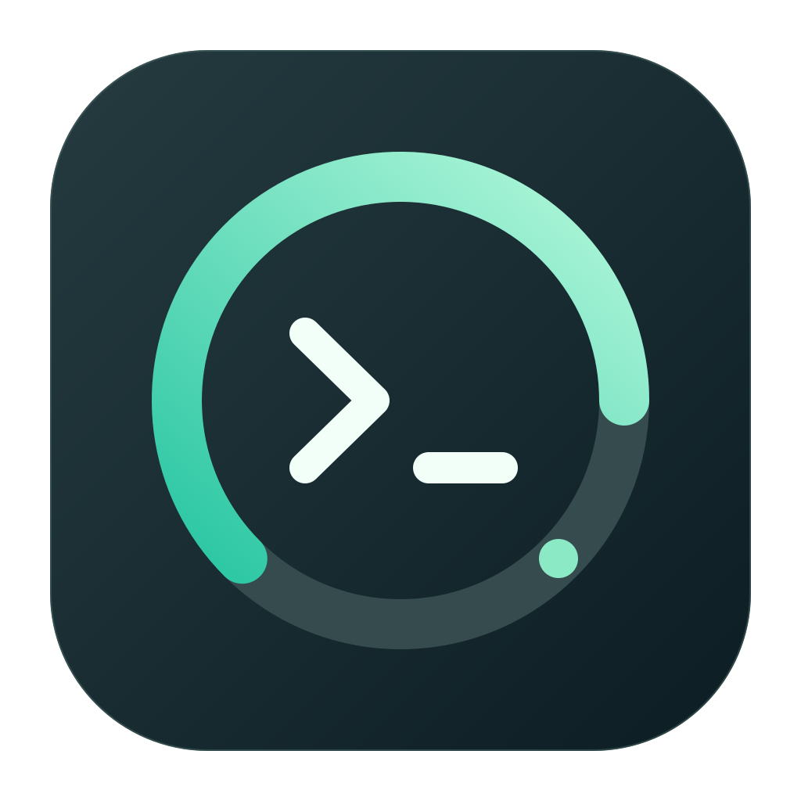
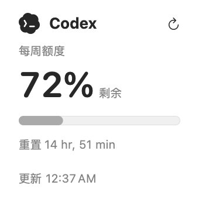
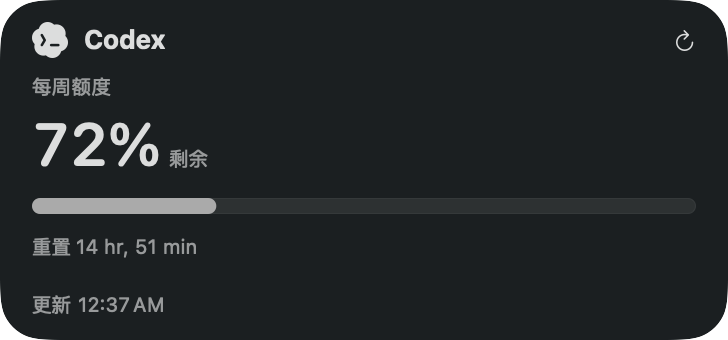

# Codex Usage

[English](README.md) · **简体中文**

<p align="center"></p>

**写代码之前，看一眼还剩多少 Codex 额度。**

原生 macOS 桌面组件，把剩余比例、重置时间和更新状态放在桌面上。无需另建账号、API Key 或服务端。

[快速开始](#构建与安装) · [贡献指南](CONTRIBUTING.md) · [报告问题](https://github.com/Daltan/codex-macos-widget/issues/new/choose)

## 界面预览

<p align="center">
  
  
</p>

使用本机成功快照生成的小号与中号原生 SwiftUI 布局渲染图，不是桌面截图；系统壁纸着色与实际桌面渲染可能不同。图中不包含账号信息。

## 为什么使用它

- **桌面可见**：小号查看首个周期，中号最多并排显示两个周期，完整数据在主应用。
- **真实数据**：只展示 Codex 返回的周期，不捏造 5 小时额度、剩余消息数或趋势。
- **登录复用**：认证交给本机 Codex，不保存第二份凭据。
- **过期可辨**：失败保留最近成功数据，并明确标记过期。
- **轻量原生**：SwiftUI + WidgetKit，支持明暗外观，没有第三方运行时依赖。

> 独立社区工具，与 OpenAI 无隶属或背书关系。主应用和小组件支持英文、简体中文，跟随系统语言；开发文档也提供中英双语。

## 组件尺寸

| 尺寸 | 适合场景 |
| --- | --- |
| 小号 | 一眼查看主要额度与重置时间 |
| 中号 | 同时查看最多两个实际返回的周期 |

新版移除了信息密度过低的大号。如果桌面仍保留旧大号，请移除后添加小号或中号。多个配额桶和其他周期仍可在主应用查看。

## 构建与安装

**[下载最新 DMG 或 ZIP](https://github.com/Daltan/codex-macos-widget/releases/latest)**，无需安装 Xcode。打开 DMG，将 **Codex Usage.app** 拖入 **Applications** 后启动。需要 macOS 14+ 和已使用 ChatGPT 账号登录的 Codex CLI。

下载版采用 **ad-hoc 临时签名，未经 Apple 公证**，首次打开可能被 macOS 阻止。请参阅[双语安装说明](Docs/INSTALL.txt)中的系统打开方式与限制；其他 Mac 的首次安装及 Intel 实机尚未验证。

### 语言切换

主应用、菜单栏、小组件、设置、错误提示和刷新操作均提供英文与简体中文资源，由 macOS 根据系统首选语言自动选择，其他不支持的语言回退到英文。修改系统语言后请重新打开应用；WidgetKit 可能保留旧时间线，等待重新加载，必要时移除后重新添加小组件。无需在应用内单独选择语言，应用也不会修改系统语言设置。

### 从源码构建

要求 macOS 14+、完整 Xcode、已登录 ChatGPT 账号的 Codex CLI。Apple Silicon 优先，项目也构建 Intel slice。无第三方库、数据库或服务器，无需 API Key。

```sh
Scripts/build.sh
Scripts/install-app.sh
```

构建还会自动在 `.build/releases/` 生成通用架构 DMG、ZIP、安装说明和 SHA-256 校验文件，详见[打包与发布说明](Docs/RELEASING.md)。

应用位于 `~/Applications/Codex Usage.app`。首次打开后，在桌面右键 → 编辑小组件 → 搜索 **Codex Usage**，选择尺寸添加。所有尺寸都有刷新按钮；点击会打开主应用，通过现有 Codex 登录重新查询。首次刷新可能需要数秒。

直接打开 `CodexUsage.xcodeproj`，选择 `CodexUsage` scheme 也可构建。默认本地 ad-hoc 签名，不需要导入证书；没有公证，其他 Mac 的首次安装与小组件加载尚未验证。构建脚本用 `DEVELOPER_DIR` 选择 Xcode，不更改系统 `xcode-select`。

找不到 CLI 时，在主应用右上角设置中选择 Codex 可执行文件。默认查找 Homebrew 与应用内 CLI。应用使用运行环境中的 `CODEX_HOME`（如设置），否则由 Codex 自行定位；Finder/LaunchAgent 不继承 shell 自定义环境，使用默认 Codex 登录。自定义环境使用者应自行保持各启动方式一致。

## 数据来源与认证

使用 [OpenAI 官方 App Server 文档](https://learn.chatgpt.com/docs/app-server) 描述的 stdio JSON-RPC 协议：

1. 启动本机 `codex app-server --stdio`，执行 `initialize` / `initialized` 握手。
2. `account/read`，`refreshToken: false`，读取账号类型及显示信息。
3. `account/rateLimits/read`，读取真实额度。
4. 查询完成后关闭子进程。不启动聊天，不调用模型，不消耗重置券，不修改订阅。

额度依据 `usedPercent`、`windowDurationMins`、`resetsAt`；剩余比例为 `100 - usedPercent`（显示限制在 0–100%）。优先使用 `rateLimitsByLimitId` 展示多个配额桶，兼容单桶字段。接口没有返回绝对可用消息数，因此不显示虚构的剩余次数；没有 5 小时周期就不创建该栏目。接口未返回窗口时明确显示缺失。

这是公开文档描述的客户端协议，并非承诺永久稳定的独立额度 REST API；CLI 将 app-server 标为 experimental。无需逆向非公开 HTTP 接口。Codex 自己管理已有登录及其必要的认证续期，监视器不读取、复制、存储 Token/Cookie，不请求或保存 API Key，不调用登录、登出或配置写入方法。程序没有直接访问 Keychain，避免形成第二套凭据。账号邮箱在持久化前掩码处理。

当前适配及真实读取验证基于 Codex CLI 0.165.0。后续协议变动只需替换 `UsageDataProvider` 实现。仅支持 ChatGPT 登录；API-key-only 账号不会冒充为 ChatGPT 套餐额度。

## 架构

```text
主应用 / 已启用的 LaunchAgent
  → UsageRefreshManager（去重、锁、超时、失败保留）
  → CodexUsageDataProvider → codex app-server → Codex 服务
  → UsageStore（原子 JSON 缓存）
  → WidgetCenter.reloadTimelines → WidgetKit

Widget 刷新按钮 → App Intent → 主应用查询
```

- `Sources/Core/UsageModel.swift`：周期、配额桶、成功快照及错误状态。
- `Sources/App/AuthenticationManager.swift`：定位 Codex 可执行文件；认证委托给 Codex。
- `Sources/App/UsageDataProvider.swift`：独立只读协议适配器，40 秒超时，限制响应缓冲大小，不记录原始 stdout/stderr。
- `Sources/App/UsageRefreshManager.swift`：主线程状态、跨进程文件锁、10 秒防连点、限流后至少 5 分钟退避。
- `Sources/Core/UsageStore.swift`：`~/Library/Application Support/CodexUsage/usage.json`，目录权限 0700，快照权限 0600，原子写入。
- `Sources/Widget/`：只读缓存、按需时间线；没有网络权限或认证目录权限。

为适配没有开发者证书的个人本机构建，扩展使用 Apple 文档支持的 [只读文件沙箱例外](https://developer.apple.com/library/archive/documentation/Miscellaneous/Reference/EntitlementKeyReference/Chapters/AppSandboxTemporaryExceptionEntitlements.html)，仅限 `/Library/Application Support/CodexUsage/`（相对用户主目录）。主应用不启用 App Sandbox，以便启动已有 Codex CLI。未关闭系统安全机制。若将来正式分发，应改用合适的签名与 App Group，并单独测试分发环境。

## 自动刷新边界

| 机制 | 行为与限制 |
| --- | --- |
| 应用启动 | 立即查询；短时间重复启动受去重限制 |
| 应用运行 | 每分钟检查是否距上次尝试满 1 小时；唤醒后补查 |
| WidgetKit | 请求每小时重新加载缓存；系统可延后，不承诺准点刷新 |
| LaunchAgent（可选） | 用户登录期间由 launchd 每 3600 秒启动一次查询，不依赖主窗口是否打开 |
| 手动刷新 | 启动主应用查询，进行中禁用按钮，完成后请求刷新小组件 |

LaunchAgent 让查询不依赖主应用常驻，但睡眠、关机、注销、断网及系统资源限制仍可能延迟执行；WidgetKit 的屏幕渲染也有自己的预算。没有任何机制能保证这些情况下仍严格每小时显示新数据。参考 [Apple WidgetKit 刷新说明](https://developer.apple.com/documentation/widgetkit/keeping-a-widget-up-to-date/)。

超过一小时、已过额度重置时间，或最新查询失败时，旧快照明确标记过期，不将历史额度自动归零或宣称已经重置。最后成功时间与最后尝试时间分开保存。不会把失败覆盖成 0% 使用量。

## 可选 LaunchAgent

安装会新增 `~/Library/LaunchAgents/com.daltan.codexusage.refresh.plist`，设置 `RunAtLoad` 和 `StartInterval=3600`，只运行本应用 `--refresh-once`。不需要 root，不修改 Codex 配置。应在知情同意后执行：

```sh
Scripts/launch-agent.sh install
Scripts/launch-agent.sh status
Scripts/launch-agent.sh uninstall
```

卸载会停止任务，将 plist 移到废纸篓，保留应用与成功缓存。关闭主应用后，后台仍可查询；若希望停止所有查询，应卸载任务并退出应用。升级应用前先退出主应用，然后重新构建并运行安装脚本。应用必须保留在安装路径，移动后需重装 LaunchAgent。

## 排障

- **认证过期**：在 Codex 中恢复登录，再点刷新。不要向本项目提供 Token 或 API Key。
- **超时/服务不可用**：检查网络和 Codex CLI 本身是否可用；旧数据会保留。查询不会输出原始服务错误，避免凭据意外进入日志。
- **缓存错误**：检查 `~/Library/Application Support/CodexUsage` 的归属是否为当前用户。不要使用 `chmod 777`。检查安装版本的 widget entitlement 是否包含首尾斜线。重新运行安装脚本后打开应用刷新。
- **小组件未出现**：先实际启动已安装主应用，退出再打开小组件选择器。检查 `pluginkit -m -A -D -i com.daltan.codexusage.widget`。本机临时签名不代表其他 Mac 也一定可加载。
- **后台未更新**：`Scripts/launch-agent.sh status` 中查看 `runs`、`last exit code` 与 `run interval`。退出码 0 表示查询成功或短时间内已有有效尝试；1 表示查询/存储失败，具体分类看应用。
- **系统日志**：`log show --last 10m --predicate 'subsystem == "com.daltan.codexusage"'`，仅包含缓存错误分类及缓存路径，不含认证信息。
- **完全卸载**：先卸载 LaunchAgent 并退出应用，再将应用移到废纸篓、移除桌面小组件。按需保留或自行删除本工具缓存及 `com.daltan.codexusage` 偏好设置，不触碰 `.codex`。

## 自动发版

Agent 按 [AGENTS.md](AGENTS.md) 完成提交到交付的闭环。实现提交后，`python3 Scripts/release.py run --bump minor --notes-file .build/next-release.md` 自动管理版本、测试、构建、tag、草稿上传、公开发布与下载回验；中断后用 `publish` 继续。完整步骤见[发布工作流](Docs/RELEASING.md)。

## 验证与仓库安全

```sh
DEVELOPER_DIR=/Applications/Xcode.app/Contents/Developer swift test
python3 Scripts/scan-secrets.py
```

测试用例中的数值仅用于模型和错误路径测试，不会进入主应用或小组件。实际运行仅使用真实接口响应，placeholder 为空状态。完整验收状态见 `Docs/VALIDATION.md`。

`.gitignore` 排除构建产物、用户 Xcode 状态、私有签名配置、证书、密钥、provisioning profile、环境文件和认证文件。提交只包含源码、项目、脚本、文档和测试；缓存、真实账号信息、原始响应及系统日志都不应入库。无需上传签名材料。

## 参与项目

欢迎报告 CLI 兼容性问题、验证不同 Mac 与系统版本、改进无障碍及本地化。提交前请阅读 [贡献指南](CONTRIBUTING.md)。

如果它帮你少切换一次窗口，欢迎点一个 **Star**，也让更多 Codex 开发者发现这个小工具。

图标矢量源文件、重建命令与第三方标识许可见 [Assets](Assets/README.md)。后续候选方向包括分发签名与真实历史数据支持；这些尚未实现。
